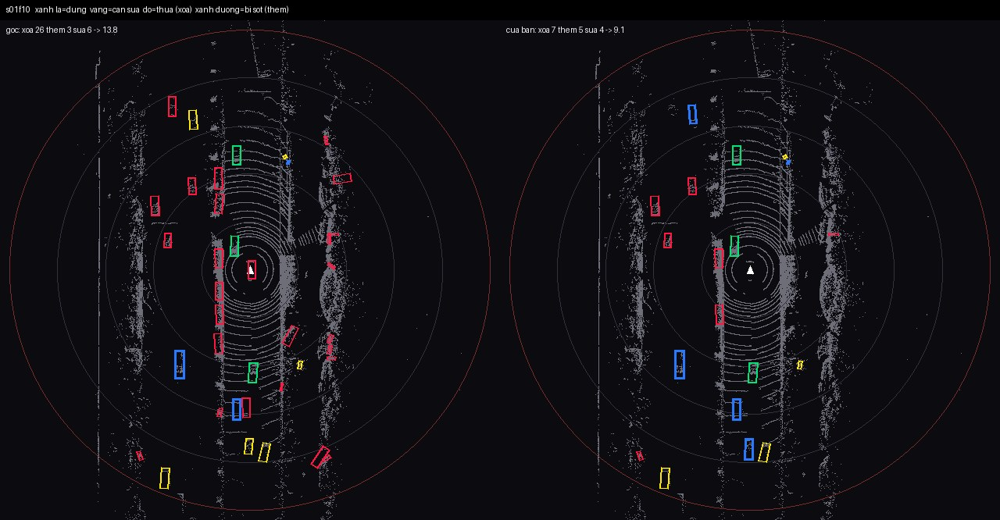

# Báo cáo Day 14 — Hà Huy Dũng — 2A202603271

- Mã học viên dùng với `--student`: `2A202603271`
- `seed_tag` trong `frames_A.txt`: `82ac3100fd`
- Tập A (tune): `s01f10 s02f12 s03f01`
- Tập B (nộp): `s01f01 s01f34 s01f56 s02f00 s02f19 s02f54 s04f08 s04f27 s04f56 s05f02 s05f22 s05f48`

## 1. Dự đoán trước sweep (bước 5b)

Ghi trước khi chạy `scripts/pp_sweep.py`, dựa trên ảnh BEV + 7 camera trong `d14_2A202603271/png_A/` và danh sách box của `pred_A.json` (cấu hình gốc `score_thr=0.1`, `min_points=0`, 81 box cho 3 frame).

- **Tham số tôi nghĩ giảm công sửa nhiều nhất:** `score_thr`, tăng lên khoảng **0.4**. `min_points` chỉ giúp một chút, tôi đoán **5** là đủ (không nên lên 10).
- **Vì sao (nhìn ảnh BEV tập A: box thừa nhiều hay box sót nhiều?):**
  - Box **thừa** nhiều hơn hẳn box sót. Ở `s01f10` (đường lớn có dải cây xanh hai bên), model đặt hàng loạt box Car đỏ và Cyclist xanh lá lên **hàng rào cây/bồn hoa** dọc lề (cam05, cam07, cam08, cam09). Riêng frame này có 12 Cyclist trong khi camera gần như không thấy người đi xe đạp/xe máy nào đang chạy.
  - Cả 3 frame đều có một box Car nằm **ngay tại tâm LiDAR** (r ≈ 0,4–0,6 m, score 0.33–0.43): đó là chính xe thu dữ liệu, chắc chắn phải xóa.
  - Các box thừa này phần lớn có score **0.25–0.45**, còn xe thật ở gần đa số có score > 0.6. Vì vậy nâng `score_thr` lên ~0.4 sẽ cắt được nhiều box thừa nhất.
  - `min_points` ít tác dụng: box trên hàng cây có rất nhiều điểm (n = 50–260), chỉ vài box gần như rỗng (n = 1, 5, 17) bị loại. Đặt quá cao (10+) có thể mất xe thật ở xa 35–45 m (chỉ 20–30 điểm).
  - Box **sót** có nhưng ít hơn: chiếc **xe buýt** phía trước ở `s01f10` (KITTI không có lớp Bus nên model không ra), vài người ở trạm chờ xe buýt, xe máy/xe đạp đang chạy ở `s02f12`. Các box này `score_thr` không cứu được.
  - Theo công thức `0.3·xóa + 1.0·thêm + 0.5·sửa`: xóa một box thừa chỉ tốn 0.3, còn lọc nhầm một xe thật thì tốn 1.0. Vì vậy tôi **không** đoán ngưỡng 0.5: ở mức đó sẽ bắt đầu mất xe thật score 0.40–0.50 (ví dụ xe đỗ ở `s03f01` có score 0.40), làm số "thêm" tăng và chi phí tăng lại.
  - Tôi đoán công sửa giảm khoảng **15–30%** so với cấu hình gốc, không nhiều hơn: số "sửa" (hộp lệch tâm > 0,3 m hoặc lệch kích thước > 0,2 m) và số "thêm" (Bus, người, xe máy bị sót) không đổi theo `score_thr`/`min_points`.

## 2. Tập A: sửa tay và tune

### 2.1. Sửa tay trên CVAT (task `D14-2A202603271-A`)

Model ra 81 box cho 3 frame. Sau khi sửa còn **40 cuboid** (`ref_A.json`: s01f10 = 13, s02f12 = 14, s03f01 = 13). Trong đó 39 box nằm trong 50 m; xe buýt phía trước ở `s01f10` có tâm cách ~52 m nên không được tính điểm.

Cách làm với từng frame: so từng box với 7 ảnh camera và point cloud (Top/Side/Front), rồi:

- **Xóa:** box Car ngay tại tâm LiDAR (chính xe thu dữ liệu, có ở cả 3 frame); các Car/Cyclist đặt lên hàng cây, bồn hoa, tường rào xanh ven đường (riêng `s01f10` có 12 box Cyclist trên hàng cây); box gần như không có điểm (1–5 điểm) mà camera không thấy vật.
- **Thêm:** những vật model bỏ sót vì KITTI không có lớp đó hoặc vì vật nhỏ/xa:
  - Bus phía trước (`s01f10`);
  - xe tải trắng bên kia dải phân cách (`s01f10`);
  - xe tải nhỏ màu trắng phía sau van đỏ (`s03f01`);
  - người ở trạm chờ xe buýt và trên vỉa hè;
  - người đi xe đạp sau hàng cây.
- **Sửa lớp:**
  - van chở hàng đỏ-trắng ở `s03f01` (model ra Car, camera dễ nhầm là Bus) → **Truck**;
  - xe van xanh chở người ở `s02f12` → **Car** (minivan theo guideline);
  - "người đi bộ" sau hàng cây ở `s01f10` thật ra đang đạp xe → **Cyclist**.
- **Sửa hình học:**
  - kéo đáy hộp sát mặt đường;
  - đặt lại chiều cao theo điểm cao nhất của vật;
  - căn mặt hộp vào phía vật quay về LiDAR (với xe bị che một nửa thì giữ kích thước chuẩn);
  - xoay lại các xe ở làn ngược chiều đang bị lệch 10–15° hoặc ngược đầu.

### 2.2. Tune (`scripts/pp_sweep.py`, lưới `score_thr` × `min_points`, 15 cấu hình)

| Cấu hình | Xóa | Thêm | Sửa | Chi phí |
|---|---:|---:|---:|---:|
| Gốc (`score_thr=0.1`, `min_points=0`) | 49 | 7 | 16 | 29.7 |
| `score_thr=0.4`, `min_points=5` (dự đoán ở mục 1) | 26 | 9 | 14 | 23.8 |
| **`best_config.json`** (`score_thr=0.5`, `min_points=0`) | **14** | **12** | **11** | **21.7** |

- **Tham số đã đổi trong `best_config.json`:** chỉ `score_thr: 0.1 → 0.5`. Các tham số còn lại giữ mặc định.
- **`min_points` không có tác dụng:** ở `score_thr = 0.4` và `0.5`, ba giá trị `min_points = 0 / 5 / 10` cho cùng chi phí. Ở `score_thr ≤ 0.3`, `min_points = 10` chỉ bớt được 2 box rỗng (−0.6 điểm). Sweep chọn dòng đầu tiên nên `min_points` vẫn là 0.
- **Kết quả leave-one-out** (dán từ output của `pp_sweep.py`):

  ```text
  s01f10: cấu hình chọn {'score_thr': '0.5', 'min_points': '0'} → 9.1 (tốt nhất có thể 9.1)
  s02f12: cấu hình chọn {'score_thr': '0.5', 'min_points': '0'} → 7.2 (tốt nhất có thể 7.2)
  s03f01: cấu hình chọn {'score_thr': '0.5', 'min_points': '0'} → 5.4 (tốt nhất có thể 5.4)
  ```

- **Cấu hình có ổn định trên từng frame không? Vì sao tôi vẫn chọn nó:**
  - Có. Bỏ ra bất kỳ frame nào thì 2 frame còn lại vẫn chọn đúng `score_thr = 0.5`, và trên frame bị bỏ ra đó cũng là cấu hình tốt nhất có thể. Frame nào cũng giảm: s01f10 13.8 → 9.1, s02f12 8.4 → 7.2, s03f01 7.5 → 5.4.
  - Có một điểm phải cẩn thận: 0.5 nằm **ở mép lưới**. Vì vậy tôi chạy thêm một sweep phụ (không nộp, chỉ để kiểm tra) với `score_thr = 0.4–0.7`, `thr_cyc = 0.5–0.9`, `size_pad_m = 0–0.2`, `min_points = 0/20`.
  - Sweep phụ chỉ xuống được **21.4** (`min_points = 20`), tức ít hơn 1 box xóa. Nhưng leave-one-out của nó **không ổn định**: mỗi frame chọn một cấu hình khác nhau, và tổng trên các frame bị bỏ ra là 22.9, tệ hơn 21.7.
  - Ngưỡng 0.6–0.7 cũng không tốt hơn 0.5, vì từ đó bắt đầu lọc mất xe thật.
  - Vậy nên tôi giữ cấu hình đơn giản và ổn định: chỉ đổi `score_thr = 0.5`, thay vì chọn cấu hình "tốt nhất" có 4 tham số đã overfit trên 3 frame.

## 3. Trước/sau (bước 8)



*Hình: `s01f10`. Trái là cấu hình gốc (xóa 26, thêm 3, sửa 6 → 13.8), phải là `best_config` (xóa 7, thêm 5, sửa 4 → 9.1). Xanh lá: đúng; vàng: cần sửa; đỏ: thừa; xanh dương: bị sót.*

- `scripts/pp_compare.py` báo **giảm 27%** công sửa trên tập A (29.7 → 21.7 trên 3 frame).
- **Dự đoán ở mục 1 đúng hay sai?** Đúng phần lớn, nhưng sai ngưỡng tối ưu:
  - **Đúng:**
    - `score_thr` là tham số quyết định. Số box xóa giảm từ 49 xuống 14, chủ yếu là các box trên hàng cây hai bên đường của `s01f10`; trên ảnh, gần như toàn bộ box đỏ ở hai mép đường biến mất.
    - `min_points` gần như không tác dụng, đúng như tôi đoán: box trên hàng cây có hàng chục đến hàng trăm điểm nên không bị lọc.
    - Mức giảm 27% nằm trong khoảng 15–30% tôi đoán, vì số box sửa (16 → 11) và các box thêm (Bus, Truck, người) không phụ thuộc vào ngưỡng.
    - Box xe ego có score 0.33–0.43 nên ngưỡng 0.5 cũng loại luôn được.
  - **Sai:** tôi đoán 0.4 tốt hơn 0.5 vì sợ mất xe thật. Thực tế 0.4 → 0.5 đúng là làm **thêm** tăng từ 9 lên 12, tức mất 3 xe thật (+3.0 điểm). Nhưng cũng bớt được 12 box thừa (−3.6) và 3 box cần sửa (−1.5), nên tổng vẫn giảm 2.1.
  - **Bài học:** trong công thức `0.3·xóa + 1.0·thêm + 0.5·sửa`, một box thừa rẻ nhưng box thừa nhiều gấp 4–10 lần box sót. Box thừa còn thường bị tính thêm điểm "sửa" khi nó chồng lên vật thật. Nhìn từng box đơn lẻ thì ngưỡng 0.4 có vẻ an toàn hơn, nhưng tính tổng thì 0.5 lợi hơn.

## 4. Tập B

Số đo từ `scripts/pp_prelabel.py --frames d14_2A202603271/frames_B.txt --config d14_2A202603271/best_config.json --gt d14_2A202603271/ref_B.json`:

| Xóa | Thêm | Sửa | Chi phí |
|---:|---:|---:|---:|
| 64 | 50 | 34 | 86.2 |

Chi tiết từng frame:

```text
s01f01  xóa  5 thêm 11 sửa 5 → 15.0
s01f34  xóa  4 thêm  1 sửa 0 →  2.2
s01f56  xóa  5 thêm 10 sửa 2 → 12.5
s02f00  xóa  2 thêm  3 sửa 0 →  3.6
s02f19  xóa 10 thêm  6 sửa 4 → 11.0
s02f54  xóa  9 thêm  3 sửa 1 →  6.2
s04f08  xóa  4 thêm  3 sửa 7 →  7.7
s04f27  xóa  1 thêm  0 sửa 6 →  3.3
s04f56  xóa  1 thêm  3 sửa 4 →  5.3
s05f02  xóa 10 thêm  3 sửa 3 →  7.5
s05f22  xóa  7 thêm  5 sửa 2 →  8.1
s05f48  xóa  6 thêm  2 sửa 0 →  3.8
TỔNG (12 frame): GT 154, dự đoán 168, khớp 104, xóa 64, thêm 50, sửa 34 → chi phí 86.2
```

- **Nhãn đã sửa:** `pred_B.json` (cấu hình đã tune) có 168 box. `ref_B.json` sau khi sửa có 157 (154 trong 50 m) cuboid: Car 121, Pedestrian 17, Cyclist 12, Truck 4, Bus 3.
- Trung bình 7.2 điểm/frame ở tập B, gần với 7.2 điểm/frame của tập A sau tune (21.7 / 3). Cấu hình không bị "vỡ" khi sang frame mới, nhưng phân bố khác hẳn: ở tập B, **thêm** chiếm 50/86.2 điểm (58%), còn ở tập A sau tune, xóa và thêm gần cân nhau.
- **Loại box tốn công sửa nhất ở tập B:**
  - **Thêm** người đi bộ và người đi xe máy/xe đạp. Ở các giao lộ (`s01f01`, `s01f56`, `s02f19`, `s05f22`), model hầu như không ra Pedestrian/Cyclist ở ngưỡng 0.5, mà mỗi box thêm tốn 1.0 điểm.
  - **Thêm** Bus/Truck: xe buýt vào giao lộ ở `s01f01`, xe buýt chạy song song ở `s02f00`, xe rác ở `s05f02`, van chở hàng ở `s05f48`. Model KITTI không có hai lớp này; khi có ra box thì cũng là Car ngắn 4–6 m và sai hướng.
  - **Xóa** box trên bụi cây/rào ven đường và **xe máy dựng không người lái** (`s01f34`, `s02f19`). Model và cả camera đều dễ nhận nhầm các xe này thành Cyclist.
  - **Sửa hướng** xe ở làn ngược chiều. Model hay ra yaw lệch 180° hoặc lệch 10–15°.

## 5. Giới hạn

- **Chỉ 3 frame để tune.** Leave-one-out ổn định với `score_thr = 0.5`, nhưng 3 frame (39 box trong 50 m) vẫn rất ít. Cả 3 frame đều là đường phố ban ngày có hàng cây. Ngưỡng 0.5 có thể quá cao với cảnh vắng, đêm hoặc nhiều người đi bộ, nơi mỗi xe thật bị lọc mất tốn 1.0 điểm.
- **Model học trên KITTI** (LiDAR 64 tia, chỉ nhìn phía trước, 3 lớp). Không có Truck/Bus nên mọi xe tải, xe buýt đều phải thêm tay hoặc sửa lớp. Model bỏ sót nhiều Pedestrian/Cyclist và hay nhầm hàng cây, rào, xe máy dựng thành Car/Cyclist. Tune ngưỡng chỉ giảm được box thừa, không giảm được box sót.
- **Chi phí là công thức, không phải thời gian sửa thật.** Giảm 27% là giảm điểm `0.3·xóa + 1.0·thêm + 0.5·sửa` trên 3 frame A, không phải "tiết kiệm 27% giờ công". Thêm một Bus thật trên CVAT (chỉnh 6 mặt, đối chiếu camera) mất nhiều thời gian hơn nhiều so với 1 điểm. Tôi chưa đo thời gian thật (phần bonus userscript).
- **Nhãn tham chiếu do một người làm**, chưa có người thứ hai kiểm chéo. Vài box tôi không chắc (theo mục 4 guideline):
  - `UNCERTAIN_CLASS`:
    - van xanh `s02f12` (Car hay Bus mini);
    - van trắng sau xe `s03f01` (Truck hay Car);
    - xe minibus trắng phía trước `s01f56` (gán Bus);
  - `UNCERTAIN_SCOPE`: xe buýt `s01f10` có tâm ~52 m;
  - `LOW_VISIBILITY`:
    - SUV trắng sau xe cảnh sát ở `s01f10`, bị che, gần như không có điểm LiDAR, vị trí suy từ camera;
    - xe tải trắng phía trước van ở `s03f01`, chỉ 3 điểm;
    - xe ở bên kia dải cây xanh (`s02f54`, `s05f02`), chỉ thấy phần nóc.
- **Hệ số mức độ khít:** box nhỏ hoặc xa (người ở 35–45 m, 13–30 điểm) có tâm và kích thước sai số lớn hơn ngưỡng 0,3 m / 0,2 m của công thức, nên số "sửa" phụ thuộc nhiều vào cách người gán nhãn đặt hộp.

